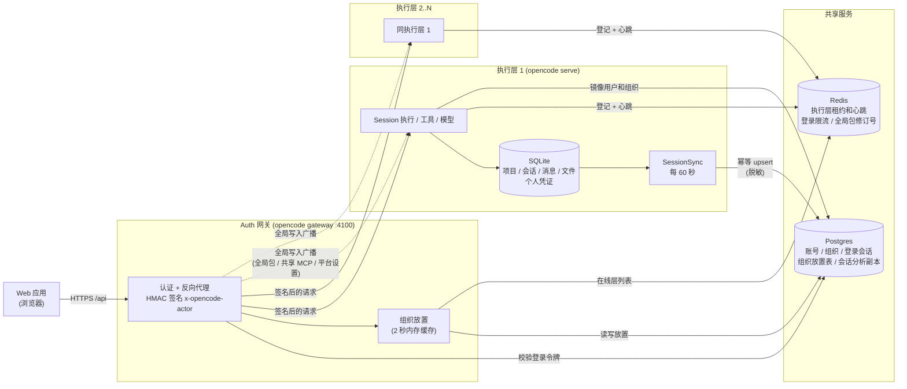
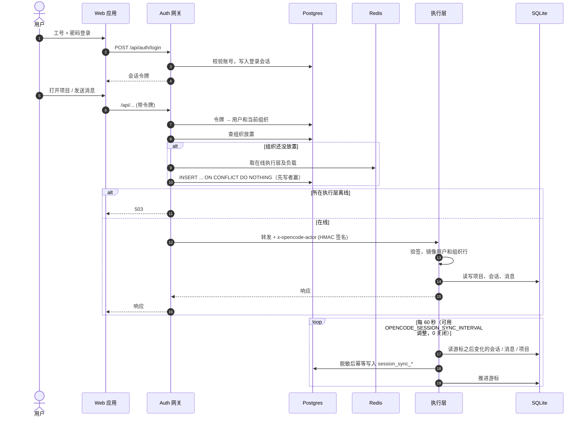
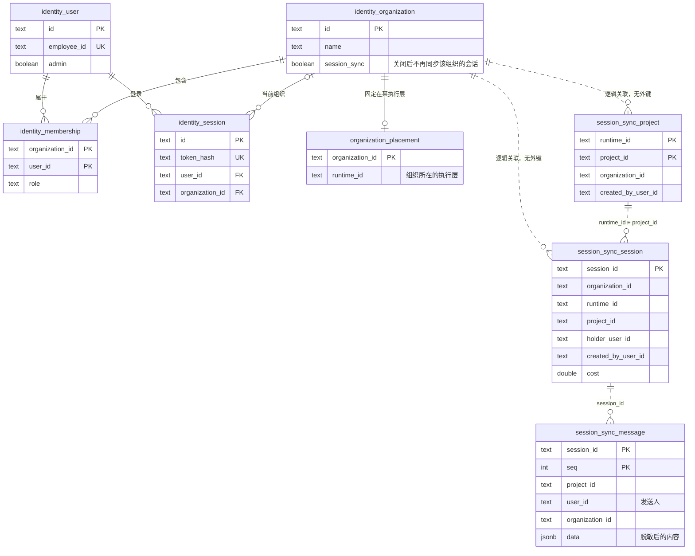

# opencode-ex

基于完整 OpenCode 仓库，移除 Electron 桌面应用及官网营销内容。保留 Web 应用、CLI、服务端、TUI、SDK 和插件；文档站点已删除。完整上游副本位于同级 `../opencode-base`，来源提交见 `UPSTREAM.json`。

## 本地运行

使用 Bun 1.4.4，在根目录安装依赖：

```sh
bun install
```

一条命令启动完整环境：Postgres 与 Redis（docker）、一个执行层（4097）、Auth 网关（4100）和 Web 前端：

```sh
bun run dev:app
```

需要 Docker。也可以分开启动：`bun run dev:infra`、`bun run dev:runtime`、`bun run dev:gateway`、`bun run dev:web`。想再加一个执行层，换一个端口和数据目录再起一次 `dev:runtime`（见 [packages/auth/README.md](packages/auth/README.md)）。

Web 默认地址为 `http://localhost:3000`，只和 Auth 网关（`http://127.0.0.1:4100`）通信，并先显示工号和密码的登录页，不再自动带上服务器密码。账号存放在 Postgres，项目和会话存放在各执行层自己的数据库，一个组织固定在一个执行层上。

网页账号和命令行用的服务器密码不是一回事。网页用工号登录。普通用户注册后还没有组织，要等平台管理员把工号加入某个租户才能进入主界面。项目归属于创建时所在的组织，切换组织后只能看到当前组织下的项目。只有平台管理员能新建租户。

第一个管理员不能靠网页注册产生。在 `deploy/.env.dev`（已被 git 忽略，不会提交；缺失时 `bun run dev:infra` 会从 `deploy/.env.dev.example` 复制）写上：

```sh
OPENCODE_ADMIN_EMPLOYEE_ID=管理员工号
OPENCODE_ADMIN_PASSWORD=至少8位的管理员密码
OPENCODE_SERVER_PASSWORD=你的测试密码
VITE_OPENCODE_SERVER_HOST=127.0.0.1
VITE_OPENCODE_SERVER_PORT=4100
```

执行层启动时，如果还没有管理员，就用上面的工号和密码创建一次。之后再改这两项不会覆盖已有管理员。`OPENCODE_SERVER_PASSWORD` 仍是命令行和本机脚本的操作者密码，能看到全部项目；网页不发送它。监听非本机地址时必须设置该密码，否则后端会生成随机密码。启动命令都会读取这个文件；网关密钥、Postgres 和 Redis 地址有开发默认值，需要时可在同一文件里用 `OPENCODE_GATEWAY_SECRET`、`OPENCODE_IDENTITY_POSTGRES_URL`、`OPENCODE_REGISTRY_URL` 覆盖。CLI / TUI 使用 `bun dev`，Web 构建使用 `bun run --cwd packages/app build`。

## 架构

浏览器只和 Auth 网关通信，网关再把请求转给执行层。账号和组织放在共享 Postgres，Redis 只存心跳和租约，项目、会话和文件留在各执行层自己的 SQLite。

### 组件



- 一个组织第一次使用时固定到一个执行层（持有组织最少的，其次负载最低），之后不再迁移；那一层离线时该组织返回 503，不会换到没有它数据的层。
- 身份类路由（`/api/auth/*`、`/api/organization*` 等）直接带用户自己的令牌，其他路由带网关签名的 actor，执行层看不到用户令牌。
- 删除组织必须到达它所在的执行层，网关按路径中的组织路由，收到 2xx 后才释放放置记录。

### 一次请求



### 共享 Postgres 的表



`session_sync_*` 三张表是给分析用的副本，故意不建外键，分析时用 LEFT JOIN。消息有发送人 `user_id`：用户消息是提交它的人，助手消息取它之前最近一条用户消息的发送人；这一版之前的旧消息没有发送人（为空），不回填。会话上另有持有人和创建人。

## 上游业务残留清理

已移除 Salesforce、官方统计站点及代理、Enterprise 反向代理和官方登录跳转、桌面更新接口、上游专用脚本与无引用截图。免费额度用尽时不再弹出 OpenCode Go 订阅窗，也不再打开官方免费模型选择。设置里的 OpenCode Free 分组、后端目录和未登录时的公开密钥配置一并移除。会话里仍保留额度说明，并把刚才的内容放回输入框；已经接入的模型继续用原来的模型列表选择。保留核心用量统计、CLI 更新查询与文件下载。云配置仅保留 ex 的 Cloudflare 资源；自定义域名通过环境变量配置，见 [部署说明](infra/README.md)。

## 本轮残留清理

已删除退役分享 Worker、官方 iOS 关联、旧仓库维护者名单、上游发布签名及 Issue/PR 自动管理脚本。CLI 本地构建与打包命令仍保留。

文档代理（`packages/console/app`）连接外部文档服务：生产构建通过 `VITE_OPENCODE_EX_V2_DOCS_URL` 配置，未配置返回 503；V1 地址不再提供。

## CI 状态

GitHub Actions 暂停，所有工作流已移至 `.github/workflows-disabled/`。重新启用前需要适配本仓库的分支、runner 与部署目标；本地检查和推送钩子仍保留。

## 官网裁剪范围

已删除 `services/www`（V2 文档站）和 `packages/web`（V1 文档站），本仓库不再自带文档站点。

移除营销首页、品牌和下载展示、Enterprise/Zen/Go 推广页、官方法律及社区跳转页、销售表单及集成、独立文章和更新日志站点。保留 Web 应用、模型/Agent 后端、文档代理和 CLI 分发/更新基础设施。

## 桌面端拆除范围

- 移除 `packages/desktop` 和桌面端 Nix 构建定义。
- 移除桌面开发命令、Turbo 桌面测试任务与 Electron 启动基准测试。
- Web 需要的图标迁移至 `packages/app/icons`，同步更新图标构建及测试路径。
- 上游发布流水线的桌面开关固定关闭；保留上游发布辅助脚本以便后续同步。
- 移除桌面 SSH、WSL、更新、配对、原生浏览器插件及 Electron 内存诊断。
- 移除 Electron 依赖和原生窗口、嵌入视图、菜单 SDK API；保留通用存储、IPC 与 Web 使用的可选契约。
- 桌面发布工作流已归档停用，专用发布和 macOS 签名脚本已删除。

本地已使用 Bun 1.4.4 安装依赖，并验证后端启动、Web 密码登录及主界面加载。桌面插件清理后，完整 lint/类型检查（34 项任务）、114 个 GUI 插件测试、232 个 Web 浏览器环境测试、2 个插件加载测试及 30 个插件宿主/组合浏览器测试通过。尚未验证模型调用、生产构建、完整 E2E 或 Nix 依赖哈希刷新。测试环境说明见 `LOCAL_TEST.md`。

## 中文说明

- [上游简体中文说明](README.zh.md)
- [上游繁體中文說明](README.zht.md)
